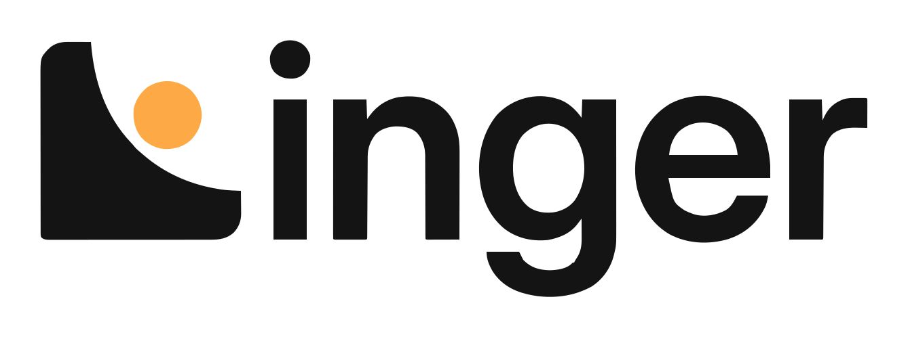
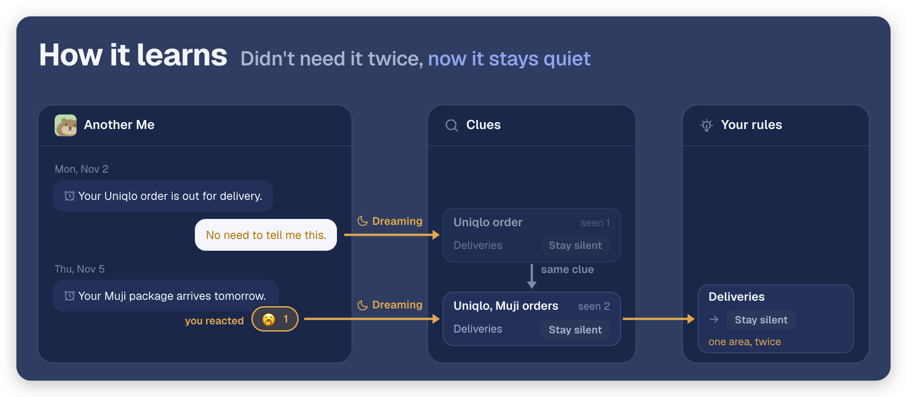

<p align="center"></p>

<p align="center"><b>Linger is an open-source personal agent with a Claude-class brain running locally on your PC.</b></p>

<p align="center">
  <b>Open-Source</b>&nbsp;&nbsp;·&nbsp;&nbsp;<b>Local AI</b>&nbsp;&nbsp;·&nbsp;&nbsp;<b>Consumer Macs &amp; PCs</b>
</p>

<p align="center">
  <a href="https://docs.heylinger.com/"></a>
  <a href="https://github.com/simplexai-labs/PolyStrata"></a>
  <a href="https://github.com/Niko1221/Strata"></a>
</p>

<p align="center">
  <a href="https://x.com/HeyLingerAI"></a>
  <a href="https://www.youtube.com/@HeyLingerAI"></a>
  <a href="https://www.reddit.com/user/HeyLinger/"></a>
</p>

<p align="center"><a href="assets/linger-story.mp4"><picture><source media="(prefers-reduced-motion: reduce)" srcset="assets/linger-story-poster.jpg"></picture></a></p>

- **A Claude-class brain, running locally.** A 125B model on a 12 GB GPU, on everyday Macs and PCs.
- **The Grok Bot experience on your PC.** Zero token fees for local inference.
- **A loyal AI sidekick.** It remembers what matters, proactively gets things done, and keeps your data on your device.

## Cool features

### Local models: A Claude-class brain on a 12 GB GPU

<a href="docs/local-inference.md"></a>

Efficient AI model–harness co-design brings a full local agent to consumer Macs and PCs. Our MoE inference engine, PolyStrata, keeps a model's busiest experts on your GPU and the rest in RAM or on SSD, so larger models run with less GPU memory: the **125B** Qwen3.8-Flash-Next runs on a **12 GB card** with 64 GB of RAM. The model runs on your own machine instead of a remote server, so there is no cloud bill and no token fee.

<details>
<summary><b>Speed:</b> how fast seven MoE models write on 8, 12 and 32 GB GPUs</summary>

<table>
  <tr>
    <th align="center" width="2200">Writing, tokens per second</th>
    <th align="center" width="2600">Laptop RTX 4070<br>8 GB</th>
    <th align="center" width="2600">RTX 3060<br>12 GB</th>
    <th align="center" width="2600">RTX 5090<br>32 GB</th>
  </tr>
  <tr><td>Qwen3.8-Flash-Next</td><td align="center">95 (IQ1_M)¹</td><td align="center">45.5</td><td align="center">179</td></tr>
  <tr><td>LFM2.5-24B-A2B</td><td align="center">70–73</td><td align="center">97.8</td><td align="center">480–485</td></tr>
  <tr><td>Flint 40B-A2.5B</td><td align="center">61–63</td><td align="center">65.5</td><td align="center">251–252</td></tr>
  <tr><td>Qwen3.6-35B-A3B</td><td align="center">94–100</td><td align="center">91.8</td><td align="center">394–395</td></tr>
  <tr><td>Ornith 1.5</td><td align="center">76–82</td><td align="center">80–82</td><td align="center">316–319</td></tr>
  <tr><td>Gemma 4 26B-A4B</td><td align="center">92–93</td><td align="center">78.0 (Q4 file)</td><td align="center">353–356</td></tr>
  <tr><td>Tiel Coder 35B-A3B</td><td align="center">83</td><td align="center">78.8</td><td align="center">337–345</td></tr>
</table>

¹ The IQ1_M result comes from the [Autopilot reference configuration](docs/local-inference.md#planning): NVIDIA 8 GB, 32 GB RAM and 64K context. The source does not specify the GPU model.

Full results (**5 more models**!) can be found in [PolyStrata](https://github.com/simplexai-labs/PolyStrata#how-fast-is-it).

</details>

### Model Autopilot: The smartest model your machine can run

<a href="docs/local-inference.md#planning"></a>

One command detects your hardware, recommends the best model, installs it and checks it. In our lab we run an architecture search: 49 language models, two inference engines, quantizations from 1-bit to 8-bit and context windows from 64K to 256K, tested tier by tier on NVIDIA cards and Macs. On your computer, the installer reads your GPU, memory and bandwidth, keeps only what fits with at least a 64K context, picks the smartest model and then the fastest, and counts it as installed only after it answers a real question.

<details>
<summary><b>By machine:</b> what each Mac and RTX tier gets, how fast it writes and which cloud model it matches</summary>

<table>
  <tr>
    <th align="left" width="2400">Hardware</th>
    <th align="left" width="2600">Recommended model</th>
    <th align="center" width="1500">Writing, tok/s</th>
    <th align="center" width="1200">SimplexAI</th>
    <th align="left" width="2700">Compares with</th>
  </tr>
  <tr><td>Mac 16 GB</td><td>Spark-X2.6-4B</td><td align="center">165</td><td align="center">31.5</td><td>Beats GPT-4o¹</td></tr>
  <tr><td>Mac 24 GB</td><td>Underdog-Saluki-27B</td><td align="center">49.7</td><td align="center">48.4</td><td>Beats Gemini 2.5 Pro</td></tr>
  <tr><td>RTX 8 GB + 32 GB</td><td>Qwen3.8-Flash-Next</td><td align="center">95</td><td align="center">51.9</td><td>≈ Claude Opus 4.5</td></tr>
  <tr><td>RTX 12 GB + 32 GB</td><td>Qwen3.8-Flash-Next</td><td align="center">120</td><td align="center">54.8</td><td>≈ Claude Sonnet 4.6</td></tr>
  <tr><td>RTX 24 GB + 64 GB</td><td>Qwen3.8-Flash-Next</td><td align="center">167</td><td align="center">59.3</td><td>≈ Claude Opus 4.6</td></tr>
</table>

<sub>SimplexAI scores sit on the third-party AIHOT scale, where 50 is the average of 123 reference models; within 3 points we say "on par". ¹ GPT-4o is not rated by AIHOT; vendor-reported GPQA Diamond 77.1 vs 53.6 and SWE-bench Verified 62.8 vs 33.2. Best results under ideal lab conditions.</sub>

</details>

### Wiki and memory: It remembers your business

<a href="docs/wiki-and-memory.md"></a>

Tell one agent, and every agent knows. Another Me reads back through your inbox, then each night files your mail, chats and meetings into wiki pages that every agent can search. It keeps the information, preferences and decisions that matter across conversations, on your device instead of in a provider's account.

### Proactive Another Me: It speaks up when it matters

<a href="docs/proactive.md"></a>

It reaches out first. Another Me watches your inbox, calendar and Slack, follows up and moves work forward, and messages you only when something needs you. And it improves itself recursively: every night it reads how its own messages landed and rewrites the rules it decides by, so every "not now" makes tomorrow's judgment sharper.

#### How it learns: recursive self-improvement, every night

Every message Another Me sends on its own is also a test. Each night, Dreaming reads how those messages landed and rewrites the rules Another Me decides by; the next day it decides with the new rules, and how those land feeds the next night. No retraining: what it learned stays a short list of rules.

<details>
<summary><b>Implicit reinforcement:</b> push back on the same kind twice, and it becomes a rule</summary>

You never state the rule; Another Me reads it from how you react. Want it sooner twice, and it tells you right away; turn it down twice, and it stays quiet.

<a href="docs/proactive.md#learning-rules"></a>

<a href="docs/proactive.md#learning-rules"></a>

</details>

<details>
<summary><b>Direct response:</b> say how you want it, and one Dreaming makes it a rule</summary>

No second time needed. Name the kind and it changes whether you are told; name the hour and it changes when.

<a href="docs/proactive.md#learning-rules"></a>

</details>

### More features

- **[Desktop and browser](docs/desktop-and-browser.md):** Your apps, your Chrome, already signed in. Agents open the apps on your Mac, Windows PC or Linux desktop and click and type the way you do, and on a Mac or Windows PC they work in your everyday Chrome with the sign-ins you already have.
- **[Agent teams](docs/team-md.md):** One plan for every agent. When a job needs more than one agent, Another Me brings in the agents you have, creates the ones it is missing, and writes one `team.md` that they all follow.
- **[Task delegation](docs/task-delegation.md):** Long work runs in the background while the chat stays with you. An agent hands long work to background copies of itself and keeps talking with you while the work runs.
- **[Model scheduling](docs/model-scheduling.md):** One model, many agents, your work first. Every agent, approval and background job shares the local model, so work you are waiting for starts at once and background work waits until the model is quiet.
- **[Bring your own runtime](docs/local-inference.md):** Claude Code, Codex or Pi, on your GPU or your subscription. Each runs as it always does, on local models or on the plan you already pay for.
- **[Voice](docs/voice.md):** Record a meeting with a live transcript, ask what was said, and hand the follow-ups to Another Me.

## Quick start

### Option 1: the desktop app

For one person on one computer. Download the package for your platform from
[GitHub Releases](https://github.com/simplexai-labs/linger/releases). The app
opens Linger, connects this computer and runs its agents. **Quick Install** on its
setup screen sets up a Linger server on this computer too.

| Platform             | Package                                                                                            |
| -------------------- | -------------------------------------------------------------------------------------------------- |
| macOS, Apple silicon | `Linger-<version>-macos-arm64.dmg`                                                                 |
| Windows x64          | `Linger-<version>-windows-x64-setup.exe`, or `-windows-x64-portable.zip` to run without installing |
| Linux x64            | `Linger-<version>-linux-x64.tar.gz` (glibc 2.35 or newer)                                          |

There is no package for Intel Macs; use Docker Compose there. Check each
download against `SHA256SUMS.txt` from the same release.

### Option 2: Docker Compose

For a server that several computers share, or to build from source. You need
Docker with Compose and at least 5 GiB of memory for its virtual machine.

```bash
git clone https://github.com/simplexai-labs/linger.git
cd linger
cp .env.example .env
docker compose up --build --detach --wait
```

Create the owner account. As written, it signs in as `owner@linger.local` with
the test password `test1234`; replace either one to use your own:

```bash
printf '%s\n' 'test1234' | docker compose exec -T teamhub \
  teamhub-account create-owner --email owner@linger.local --password-stdin
```

Change the test password in **Settings › Security** before other people can
reach the server.

Open <http://localhost:3000> and sign in. The app then shows the commands that
connect your computer. See
[Install with Docker Compose](https://docs.heylinger.com/install/docker-compose)
to serve other computers on your network and to turn on voice.

## Learn more

The full documentation lives at **[docs.heylinger.com](https://docs.heylinger.com/)**.

<table>
  <tr>
    <th width="180" align="left">&nbsp;Set up</th>
    <th width="520" align="left">What it covers</th>
  </tr>
  <tr>
    <td><a href="https://docs.heylinger.com/install/desktop-app">Desktop app</a></td>
    <td>Install the app, or build it from source.</td>
  </tr>
  <tr>
    <td><a href="https://docs.heylinger.com/models/choose-a-runtime">Choose a runtime</a></td>
    <td>Claude Code, Codex or Pi, on local models or a subscription.</td>
  </tr>
  <tr>
    <td><a href="docs/self-hosting.md">Self-hosting</a></td>
    <td>Run it with Docker Compose to serve several computers.</td>
  </tr>
  <tr>
    <td><a href="docs/self-hosting.md#troubleshooting">Troubleshooting</a></td>
    <td>Fixes for when something does not start.</td>
  </tr>
</table>

## Contributors

<p>
  <a href="https://github.com/simplexai-labs/linger/graphs/contributors">
    
  </a>
</p>

New here? Read the [contribution guide](CONTRIBUTING.md) and pick a [good first issue](https://github.com/simplexai-labs/linger/issues?q=is%3Aissue%20state%3Aopen%20label%3A%22good%20first%20issue%22).

## Community & Contact

Choose the channel that best fits your question:

- [GitHub Issues](https://github.com/simplexai-labs/linger/issues): report reproducible bugs and track engineering work. Read the [contribution guide](CONTRIBUTING.md) before opening one.
- [Email](mailto:tonyzhang@simplexai.com): write to tonyzhang@simplexai.com for anything that does not fit an issue.
- [Security policy](SECURITY.md): report a vulnerability privately, never in a public issue.

## Acknowledgements

Linger is built on these open-source projects:

- **[PolyStrata](https://github.com/simplexai-labs/PolyStrata):** Runs local models, keeping the experts a model uses most on your GPU.
- **[Strata](https://github.com/Niko1221/Strata):** The inference engine PolyStrata is built on. It runs Qwen3.8-Flash-Next.
- **[BlockNote](https://github.com/TypeCellOS/BlockNote), [Yjs](https://github.com/yjs/yjs) and [Hocuspocus](https://github.com/ueberdosis/hocuspocus):** Power the documents that people and agents edit together.
- **[Hindsight](https://github.com/vectorize-io/hindsight):** Where agent memory's fact extraction and search come from.
- **[Cua](https://github.com/trycua/cua):** Lets agents use the apps on your desktop.
- **[LiveKit](https://github.com/livekit/livekit):** Carries the audio for voice and meetings.
- **[River](https://github.com/riverqueue/river):** Runs TeamHub's background jobs.
- **[NOTICE](NOTICE):** Lists every third-party component, what we adapted from it, and the license that applies.

Thank you to the open-source community for libraries this powerful and this simple: they let us focus on the product itself, and we hope our projects will in turn give everyone an easier-to-use knowledge base.

## Feature Request

Have an idea? [Open a feature request](https://github.com/simplexai-labs/linger/issues/new?template=feature_request.yml) and describe the problem it would solve.

## Star History

<a href="https://www.star-history.com/#simplexai-labs/linger&type=date&legend=top-left">
  <picture>
    <source media="(prefers-color-scheme: dark)" srcset="https://api.star-history.com/svg?repos=simplexai-labs%2Flinger&type=date&theme=dark&legend=top-left" />
    <source media="(prefers-color-scheme: light)" srcset="https://api.star-history.com/svg?repos=simplexai-labs%2Flinger&type=date&legend=top-left" />
    
  </picture>
</a>

## License

This repository is licensed under the [Linger Open Source License](LICENSE),
based on Apache 2.0 with additional conditions. [NOTICE](NOTICE) lists
third-party code and the logos and images that this license does not cover.
