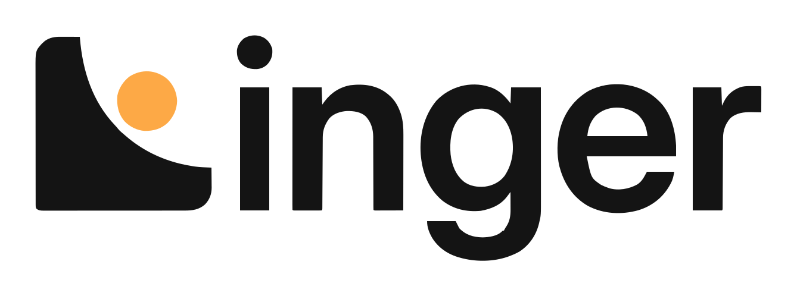
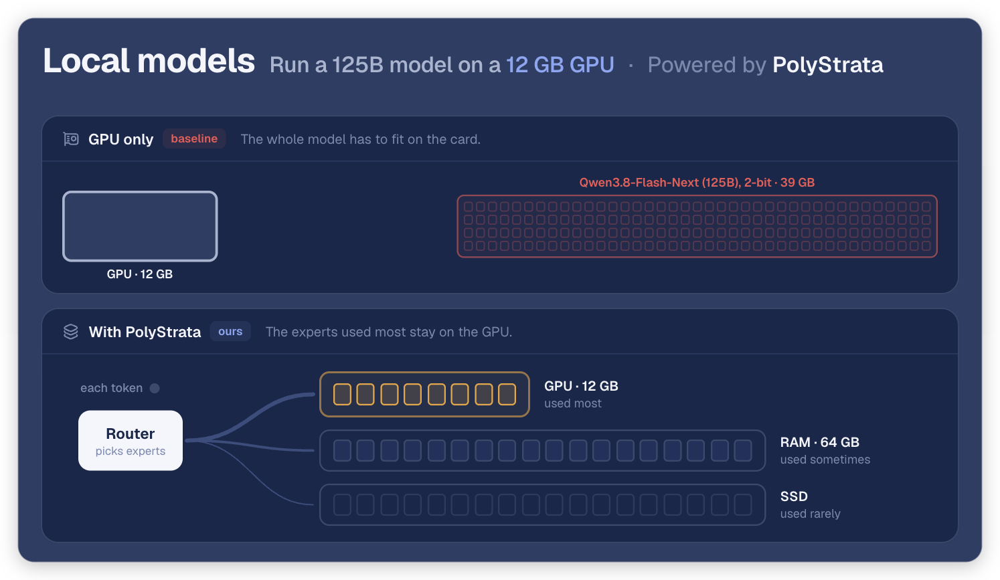
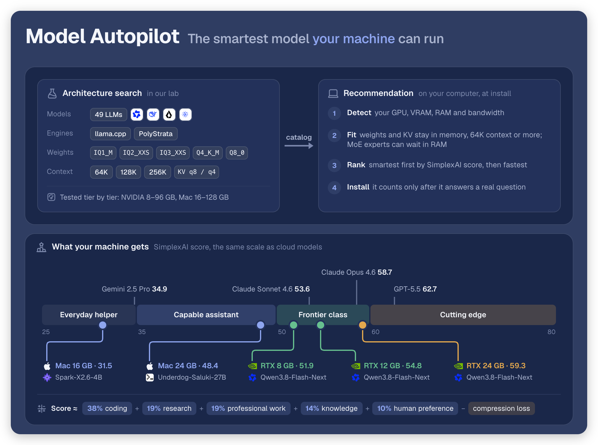
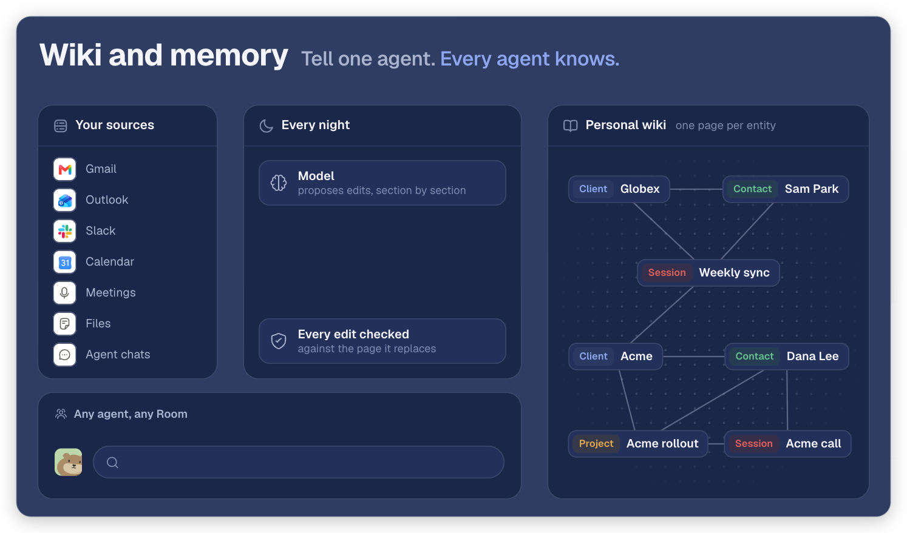
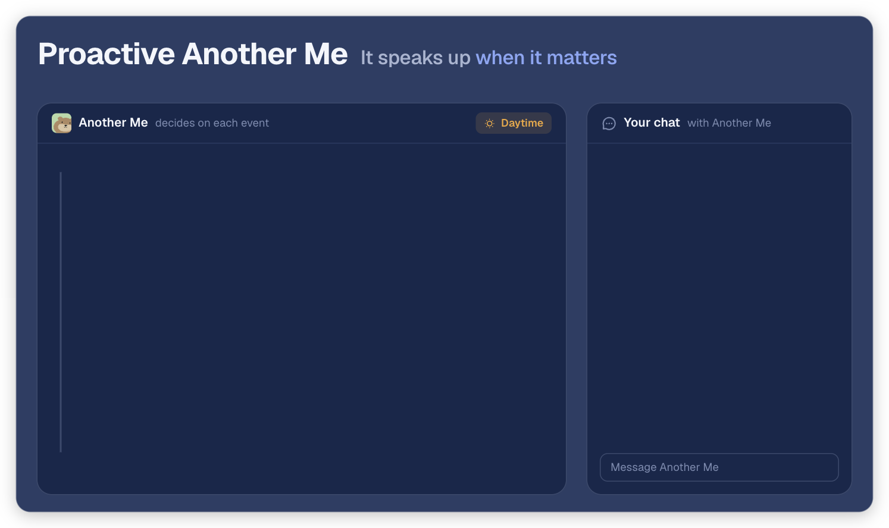
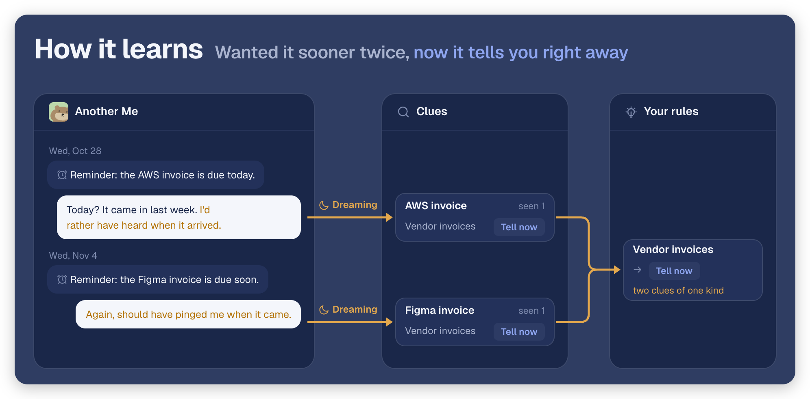
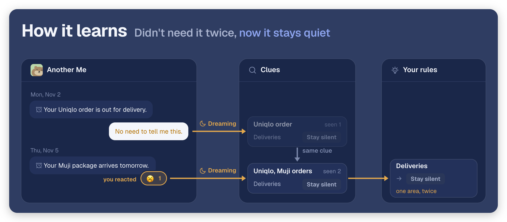
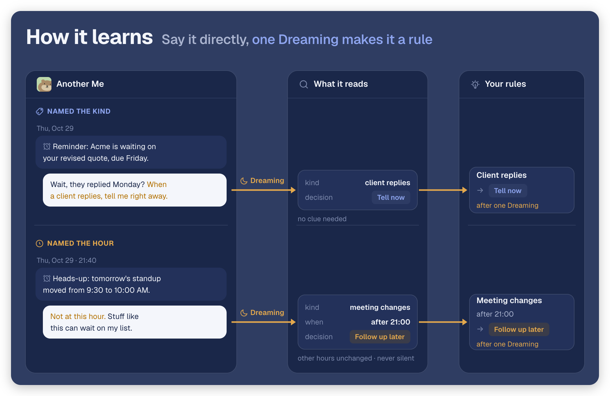

<p align="center"></p>

<p align="center"><b>Linger 是一个开源的个人 Agent，Claude 级大脑就运行在你自己的电脑上。</b></p>

<p align="center">
  <b>开源</b>&nbsp;&nbsp;·&nbsp;&nbsp;<b>本地 AI</b>&nbsp;&nbsp;·&nbsp;&nbsp;<b>消费级 Mac 与 PC</b>
</p>

<p align="center">
  <a href="https://docs.heylinger.com/"></a>
  <a href="https://github.com/simplexai-labs/PolyStrata"></a>
  <a href="https://github.com/Niko1221/Strata"></a>
</p>

<p align="center">
  <a href="https://discord.gg/bmgnw6pdZ7"></a>
  <a href="https://x.com/HeyLingerAI"></a>
  <a href="https://www.youtube.com/@HeyLingerAI"></a>
  <a href="https://www.reddit.com/user/HeyLinger/"></a>
</p>

<p align="center"><a href="README.md">English</a>&nbsp;&nbsp;·&nbsp;&nbsp;<b>简体中文</b></p>

<p align="center"><a href="assets/linger-story.mp4"><picture><source media="(prefers-reduced-motion: reduce)" srcset="assets/linger-story-poster.jpg"></picture></a></p>

- **Claude 级的大脑，本地运行。** 在 12 GB 显卡上跑 125B 模型，就在日常的 Mac 和 PC 上。
- **把 Grok Bot 的体验搬到你的电脑。** 本地推理零 token 费用。
- **一个忠诚的 AI 伙伴。** 它记住重要的事，主动把事情做完，并把数据留在你的设备上。

## 酷炫功能

### 本地模型：12 GB 显卡上的 Claude 级大脑

<a href="docs/local-inference.md"></a>

AI 模型与 harness 的高效协同设计，把完整的本地 Agent 带到消费级 Mac 与 PC 上。我们的 MoE 推理引擎 PolyStrata 把模型最常使用的专家留在你的显卡上，其余放在内存或 SSD 里，于是更大的模型只需更少的显存：**125B** 的 Qwen3.8-Flash-Next 在 **12 GB 显卡** 加 64 GB 内存上就能跑。模型在你的机器上运行而不是远程服务器，因此没有云账单，也没有 token 费用。

<details>
<summary><b>速度：</b>七款 MoE 模型在 8、12、32 GB 显卡上的写入速度</summary>

<table>
  <tr>
    <th align="center" width="2200">写入，token/秒</th>
    <th align="center" width="2600">笔记本 RTX 4070<br>8 GB</th>
    <th align="center" width="2600">RTX 3060<br>12 GB</th>
    <th align="center" width="2600">RTX 5090<br>32 GB</th>
  </tr>
  <tr><td>Qwen3.8-Flash-Next</td><td align="center">—</td><td align="center">45.5</td><td align="center">179</td></tr>
  <tr><td>LFM2.5-24B-A2B</td><td align="center">70–73</td><td align="center">97.8</td><td align="center">480–485</td></tr>
  <tr><td>Flint 40B-A2.5B</td><td align="center">61–63</td><td align="center">65.5</td><td align="center">251–252</td></tr>
  <tr><td>Qwen3.6-35B-A3B</td><td align="center">94–100</td><td align="center">91.8</td><td align="center">394–395</td></tr>
  <tr><td>Ornith 1.5</td><td align="center">76–82</td><td align="center">80–82</td><td align="center">316–319</td></tr>
  <tr><td>Gemma 4 26B-A4B</td><td align="center">92–93</td><td align="center">78.0 (Q4 文件)</td><td align="center">353–356</td></tr>
  <tr><td>Tiel Coder 35B-A3B</td><td align="center">83</td><td align="center">78.8</td><td align="center">337–345</td></tr>
</table>

完整结果（**还有 5 个模型**！）见 [PolyStrata](https://github.com/simplexai-labs/PolyStrata#how-fast-is-it)。

</details>

### 模型自动驾驶：让你的机器跑得起最聪明的模型

<a href="docs/local-inference.md#planning"></a>

一条命令探测你的硬件、推荐最合适的模型、装好并验证它。我们在实验室里做架构搜索：49 个语言模型、两个推理引擎、从 1-bit 到 8-bit 的量化、64K 到 256K 的上下文窗口，在 NVIDIA 显卡与 Mac 上逐档测试。在你的电脑上，安装器读取显卡、内存与带宽，只保留能在至少 64K 上下文下装得下的候选，先挑最聪明的再挑最快的，而且要等它真正回答一个问题之后才算安装完成。

<details>
<summary><b>按机器看：</b>每一档 Mac 与 RTX 拿到什么模型、写入速度多快、对标哪个云端模型</summary>

各档硬件的推荐模型、写入速度与对标云端模型的表格由脚本从内部数据生成，为避免两处数据漂移，这里不复制：请看[英文 README 的同一节](README.md#model-autopilot-the-smartest-model-your-machine-can-run)，或在 [本地推理](docs/local-inference.md#planning) 里查看测试条件、默认值与自检方法。

</details>

### Wiki 与记忆：它记得你的业务

<a href="docs/wiki-and-memory.md"></a>

告诉一个 Agent，所有 Agent 就都知道了。Another Me 会回读你的收件箱，然后每晚把你的邮件、聊天与会议整理成每个 Agent 都能检索的 wiki 页面。它把跨对话的重要信息、偏好与决定留在你的设备上，而不是放进某家服务商的账户里。

<details>
<summary><b>它怎么工作：</b>你的信息来源每晚变成 wiki 页面，所有 Agent 都能检索</summary>

<a href="docs/wiki-and-memory.md"></a>

</details>

### 主动的 Another Me：需要的时候它才开口

<a href="docs/proactive.md"></a>

它会先伸手。Another Me 盯着你的收件箱、日历与 Slack，跟进并把事情往前推，只在真的需要你时才给你发消息。它还会递归地自我改进：每晚它回看自己发出的消息反响如何，并重写自己据以判断的规则，于是每一次"现在不用"都让明天的判断更准。

#### 它怎么学习：每晚递归自我改进

Another Me 主动发出的每条消息同时也是一次测试。每晚，Dreaming 回看这些消息的反响，重写 Another Me 据以判断的规则；第二天它用新规则判断，而这些判断的结果又会喂给下一晚。没有重新训练：它学到的东西始终是一张很短的规则列表。

<details>
<summary><b>隐式强化：</b>同一类事被推回两次，它就变成一条规则</summary>

你从不明说规则；Another Me 从你的反应里读出来。想让它更早提醒两次，它就改成立刻告诉你；拒绝两次，它就保持安静。

<a href="docs/proactive.md#learning-rules"></a>

<a href="docs/proactive.md#learning-rules"></a>

</details>

<details>
<summary><b>直接告诉它：</b>说出你想要的方式，一次 Dreaming 就把它变成规则</summary>

不需要第二次。说出类别，它就改变是否告诉你；说出时段，它就改变什么时候告诉你。

<a href="docs/proactive.md#learning-rules"></a>

</details>

### 更多功能

- **[桌面与浏览器](docs/desktop-and-browser.md)：** 你的应用、你的 Chrome，登录状态已经就绪。Agent 会在你的 Mac、Windows PC 或 Linux 桌面上打开应用，像你一样点击与输入；在 Mac 或 Windows PC 上，它们在你日常使用的 Chrome 里工作，用你已经登录好的账号。
- **[Agent 团队](docs/team-md.md)：** 所有 Agent 共用一份计划。当一件事需要不止一个 Agent 时，Another Me 会召集你已有的 Agent、创建缺的那些，并写一份所有人都遵循的 `team.md`。
- **[任务委派](docs/task-delegation.md)：** 长任务在后台跑，聊天始终留给你。Agent 把长任务交给自己的后台副本，工作继续的同时仍然和你对话。
- **[模型调度](docs/model-scheduling.md)：** 一个模型、多个 Agent，你的工作优先。每个 Agent、审批与后台任务共用本地模型，所以你在等的工作立刻开始，后台工作等模型空闲再做。
- **[自带运行时](docs/local-inference.md)：** Claude Code、Codex 或 Pi，跑在你的显卡或你的订阅上。它们各自照旧运行，用本地模型，或用你已经付费的方案。
- **[语音](docs/voice.md)：** 录一场会议并实时转写，问它刚才说了什么，再把后续交给 Another Me。

## 快速开始

### 方案一：桌面应用（Beta）

> [!NOTE]
> 桌面应用目前处于 **Beta** 阶段并在积极开发中。安装或升级时可能遇到粗糙之处（例如 Windows 安装包尚未签名时的 SmartScreen 警告，或首次运行时本地运行时与模型下载较慢）。如果出现问题，请看[安装桌面应用](https://docs.heylinger.com/install/desktop-app)、在 [Discord](https://discord.gg/bmgnw6pdZ7) 里提问，或[开一个 issue](https://github.com/simplexai-labs/linger/issues)。

适合一个人用一台电脑。在下面选择你的平台。应用会打开 Linger、连接这台电脑并运行它的 Agent；设置页上的 **快速安装** 还会在这台电脑上装好一个 Linger 服务器。

| 平台                                                                                      | 安装包                                                                           |
| ----------------------------------------------------------------------------------------- | -------------------------------------------------------------------------------- |
| [macOS 14.0 或更高，Apple 芯片](https://github.com/simplexai-labs/linger/releases/latest) | `Linger-<version>-macos-arm64.dmg`                                               |
| [Windows x64](https://github.com/simplexai-labs/linger/releases/latest)                   | `Linger-<version>-windows-x64-setup.exe`，或免安装的 `-windows-x64-portable.zip` |
| [Linux x64](https://github.com/simplexai-labs/linger/releases/latest)                     | `Linger-<version>-linux-x64.tar.gz`（需要 glibc 2.35 或更高）                    |

Intel Mac 没有安装包，请在那类机器上使用 Docker Compose。每个下载都用同一发布里的 `SHA256SUMS.txt` 校验。

安装步骤与设置失败时的排错，见[安装桌面应用](https://docs.heylinger.com/install/desktop-app)。

### 方案二：Docker Compose

适合多台电脑共用的服务器，或者从源码构建。你需要带 Compose 的 Docker，并给它的虚拟机至少 5 GiB 内存。

```bash
git clone https://github.com/simplexai-labs/linger.git
cd linger
cp .env.example .env
docker compose up --build --detach --wait
```

创建所有者账号。如下所示会以 `owner@linger.local` 和测试密码 `test1234` 登录；换成你自己的即可：

```bash
printf '%s\n' 'test1234' | docker compose exec -T teamhub \
  teamhub-account create-owner --email owner@linger.local --password-stdin
```

在别人能访问这台服务器之前，请先在 **设置 › 账号** 里改掉测试密码。

打开 <http://localhost:3000> 并登录。应用随后会显示连接你这台电脑的命令。要让局域网内其他电脑使用、并开启语音，见[用 Docker Compose 安装](https://docs.heylinger.com/install/docker-compose)。

#### 本地模型

Compose 容器只运行 Linger 服务器；模型与 Agent 跑在你连接的那台电脑上。在那台电脑上运行引导式安装器：

```bash
# macOS（Apple 芯片）或 Linux
./scripts/install/install.sh
```

```powershell
# Windows（x64，普通非管理员 PowerShell）
powershell -ExecutionPolicy Bypass -File .\scripts\install\install.ps1
```

它会检查你的硬件，在你确认后安装并验证一个本地模型，并把 `linger-computer` 连接到你的 Linger 服务器。用 `--help` 查看日常命令（`--status`、`--up`、`--remove`），其他模型方案见[自带运行时](docs/local-inference.md)。

如果 Compose 的端口被占用，安装器会提示选择空闲端口。它把 LiveKit 的端口映射与对应的 RTC 启动参数写进 `.local/compose.ports.yml`，并通过 `.env` 启用这个覆盖文件。这需要 Docker Compose 2.24.4 或更高。重跑安装器会复用这些端口。

## 深入了解

完整文档在 **[docs.heylinger.com](https://docs.heylinger.com/)**。

<table>
  <tr>
    <th width="180" align="left">&nbsp;安装</th>
    <th width="520" align="left">涵盖内容</th>
  </tr>
  <tr>
    <td><a href="https://docs.heylinger.com/install/desktop-app">桌面应用</a></td>
    <td>安装应用，或从源码构建。</td>
  </tr>
  <tr>
    <td><a href="https://docs.heylinger.com/models/choose-a-runtime">选择运行时</a></td>
    <td>Claude Code、Codex 或 Pi，用本地模型或订阅。</td>
  </tr>
  <tr>
    <td><a href="docs/self-hosting.md">自托管</a></td>
    <td>用 Docker Compose 运行，服务多台电脑。</td>
  </tr>
  <tr>
    <td><a href="docs/self-hosting.md#troubleshooting">排错</a></td>
    <td>启动不起来时怎么办。</td>
  </tr>
</table>

## 贡献者

<p>
  <a href="https://github.com/simplexai-labs/linger/graphs/contributors">
    
  </a>
</p>

第一次来？先读[贡献指南](CONTRIBUTING.md)，再挑一个 [good first issue](https://github.com/simplexai-labs/linger/issues?q=is%3Aissue%20state%3Aopen%20label%3A%22good%20first%20issue%22)。

## 社区与联系

按你的问题类型选择渠道：

- [GitHub Issues](https://github.com/simplexai-labs/linger/issues)：报告可复现的缺陷、跟踪工程进展。提交前请先读[贡献指南](CONTRIBUTING.md)。
- [邮件](mailto:tonyzhang@simplexai.com)：不适合开 issue 的事情，写信到 tonyzhang@simplexai.com。
- [安全策略](SECURITY.md)：漏洞请私下报告，永远不要发在公开 issue 里。

在 GitHub 上给 Linger 点个 Star 就能跟上进展，并选择 **Watch → Custom → Releases** 接收每个新版本的通知。

<a href="https://github.com/simplexai-labs/linger"></a>

## 致谢

Linger 建立在这些开源项目之上：

- **[PolyStrata](https://github.com/simplexai-labs/PolyStrata)：** 运行本地模型，把模型最常使用的专家留在你的显卡上。
- **[Strata](https://github.com/Niko1221/Strata)：** PolyStrata 建立其上的推理引擎，运行 Qwen3.8-Flash-Next。
- **[BlockNote](https://github.com/TypeCellOS/BlockNote)、[Yjs](https://github.com/yjs/yjs) 与 [Hocuspocus](https://github.com/ueberdosis/hocuspocus)：** 支撑人与 Agent 共同编辑的文档。
- **[Hindsight](https://github.com/vectorize-io/hindsight)：** Agent 记忆的事实抽取与检索来自这里。
- **[Cua](https://github.com/trycua/cua)：** 让 Agent 使用你桌面上的应用。
- **[LiveKit](https://github.com/livekit/livekit)：** 承载语音与会议的音频。
- **[River](https://github.com/riverqueue/river)：** 运行 TeamHub 的后台任务。
- **[NOTICE](NOTICE)：** 列出每一个第三方组件、我们从中学了什么，以及适用的许可证。

感谢开源社区提供如此强大又如此简单的库：它们让我们能把精力放在产品本身，也希望我们的项目能反过来给大家一个更好用的知识库。

## 功能建议

有想法？[提交一个功能建议](https://github.com/simplexai-labs/linger/issues/new?template=feature_request.yml)，说明它能解决什么问题。

## Star 历史

<a href="https://www.star-history.com/#simplexai-labs/linger&type=date&legend=top-left">
  <picture>
    <source media="(prefers-color-scheme: dark)" srcset="https://api.star-history.com/svg?repos=simplexai-labs%2Flinger&type=date&theme=dark&legend=top-left" />
    <source media="(prefers-color-scheme: light)" srcset="https://api.star-history.com/svg?repos=simplexai-labs%2Flinger&type=date&legend=top-left" />
    
  </picture>
</a>

## 许可证

本仓库使用 [Linger 开源许可证](LICENSE)，以 Apache 2.0 为基础并附加条件。[NOTICE](NOTICE) 列出了第三方代码，以及本许可证不覆盖的标识与图片。
