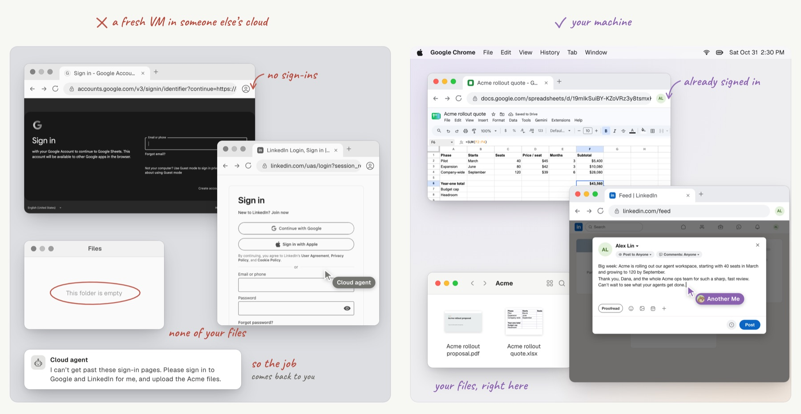
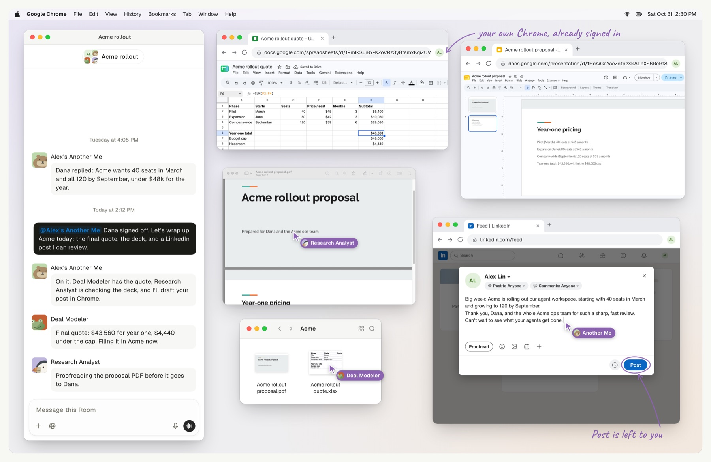

# Desktop and Browser

**Not a fresh VM with an empty browser: your apps, your Chrome, already signed
in.**

Your agents use your Mac, Windows PC or Linux desktop the way you do: they open
the app, read each window the way a screen reader does, then click and type. On
a Mac or Windows PC, connect your everyday Chrome once, and they work in Google
Sheets, Slides or LinkedIn as you, with the sign-ins you already have; the key
that links them is stored only on your machine and never enters the chat or the
model. On a Mac, switch to another app yourself, and the agent stops typing
instead of pulling the window back.

How agents take turns on the screen without sending an input twice is in
[Architecture](architecture.md#inside-cua-playwright-and-shell).
