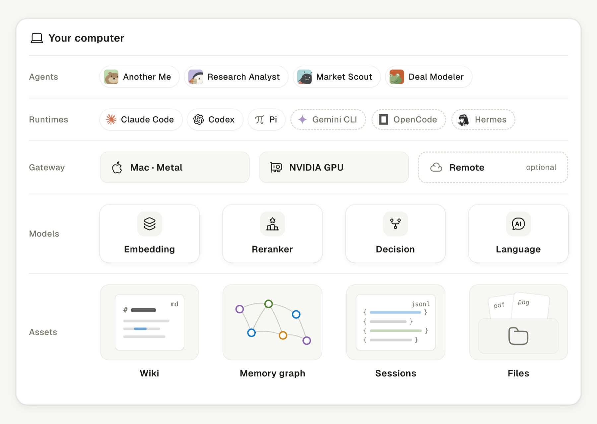

# Local Inference

**From the agent to its memory, every layer lives on your machine.**

Claude Code, Codex and Pi run as they always do, while a local gateway points
them at models on your own machine, with Gemini CLI, OpenCode and Hermes coming
next. Your wiki, memory, sessions and files stay on your disk, and a remote
model or the subscription you already pay for joins only when you ask. One
install sets up a language model, and it stays quick even on a fanless laptop.

How agents, approvals and background work share a model is in
[Model scheduling](model-scheduling.md).

## Model source

Each computer serves all of its agents from one source at a time. Setup asks
for it, and **Settings › Models** switches it later to Local model or BYOK; it
does not offer a switch to Subscription.

| Source       | Runtime                  | Where the model runs                                                                       |
| ------------ | ------------------------ | ------------------------------------------------------------------------------------------ |
| Local model  | Pi                       | A model loaded on this computer, through the local gateway                                 |
| Subscription | Claude Code or Codex     | The plan the runtime is signed in to, with its own settings                                |
| BYOK         | Claude Code, Codex or Pi | Your own OpenAI-compatible or Anthropic endpoint, key and model, through the local gateway |

For BYOK you enter the base URL and key, and optionally a path and an
endpoint. Requests go to base URL + path + endpoint: the path defaults to
`/v1` and the endpoint to the runtime's own (`/messages` for Claude Code,
`/responses` for Codex, `/chat/completions` for Pi), and `-` leaves either one
out, so a provider under `/api/paas/v4` or a full request address pasted into
the base URL works too. The full address's ending sets the request format
(OpenAI Chat Completions, OpenAI Responses or Anthropic Messages); an address
that ends otherwise uses the runtime's own format. Nothing is probed: the refresh
button lists models at base URL + path + `/models`, with their names and
context windows, and **Test** sends one request to the full address. You type
the model ID when the endpoint lists none. BYOK needs a Computer at 0.56.0 or
later. The key stays on the computer in an owner-only file; the server never
stores or shows it. A switch moves every agent on the computer to the new runtime and
model, and leaving Local model unloads the local models to free memory. When an
agent is still working, the switch asks first and ends that work only if you
confirm.

## Web search

On Subscription, Claude Code and Codex keep their own web search, and agents
are told to use it first and `teamhub web search` and `teamhub web open` when it
fails. On Local model and BYOK the gateway cannot run that provider-hosted
search, so the computer turns it off and agents search and read pages only with
`teamhub web search` and `teamhub web open`, as Pi always does. A Claude Code
or Codex that reaches its model through an API endpoint set up in its own
configuration keeps its web tools, but agents are told to use the `teamhub web`
commands instead, since those tools may not work through that API. The
commands use the web search providers set up on the server (Tavily, Brave
Search, Firecrawl, Exa or You.com).
Without any key they search DuckDuckGo, which is free but blocks searches that
come too often; You.com also works without a key, with lower quality. Pages are
read from this computer by default. When a provider needs a key, a card in the
chat asks for it.

## Background Memory and Wiki

Memory facts and reports, Agent Memory, and personal Wiki generation use the
Runtime on the Computer where the relevant Agent is placed. On Pi, these calls
require a Computer Daemon at 0.55.0 or later and run on the same model as
Pi's own work: its default model, whether that is a local model or your own
endpoint and key. Under Local model, downloaded is not loaded; load the model
from setup or **Settings › Models**. Background Pi calls run without tools or
a saved Pi session. If Pi or its model is unavailable, they wait or fail with
a Runtime error; they never switch to Codex or Claude Code.

A Codex or Claude Code placement can still use the other ready Runtime on
that Computer. These calls use the chosen Runtime's default endpoint; if
that endpoint is remote, it receives the input needed for the task.

## Planning

The planner chooses hardware and model settings together: layer by layer, the
machine's platform, free memory and bandwidth narrow the catalog until one model,
quantization, context window and KV precision remain, and the smaller models are
packed around it.

<!-- BEGIN GENERATED: public-tiers tiers, from llm-inference-lab docs/public-tiers.json; run scripts/public_tiers_sync.py there, do not edit here -->

| Machine                    | Model               | Quant                                             | Context | Decode, tok/s                                                                          | SimplexAI    | Compares with       |
| -------------------------- | ------------------- | ------------------------------------------------- | ------- | -------------------------------------------------------------------------------------- | ------------ | ------------------- |
| Mac 16 GB                  | Spark-X2.6-4B       | Q4_K_M                                            | 64K     | ~41 (est.)                                                                             | ~31.5 (est.) | ≈ Gemini 2.5 Pro    |
| Mac 24 GB                  | Inkling 2 Mini      | Unsloth Dynamic 3.0 UD-IQ3_XXS                    | 64K     | 29.12 short; 26.15 after 8K; 22.28 after 32K; 29.89 for 2 concurrent sessions together | 53.4         | ≈ Claude Sonnet 4.6 |
| Mac 32 GB                  | Inkling 2 Mini      | Unsloth Dynamic 3.0 UD-Q4_K_M                     | 128K    | ~30 (est.)                                                                             | 54.2         | ≈ Claude Sonnet 4.6 |
| Linux NVIDIA 8 GB + 32 GB  | Inkling 2 Mini      | Unsloth Dynamic 3.0 UD-Q3_K_XL (Mainline_Support) | 64K     | ~50 (est.)                                                                             | 53.9         | ≈ Claude Sonnet 4.6 |
| Linux NVIDIA 12 GB + 32 GB | Inkling 2 Mini      | Unsloth Dynamic 3.0 UD-Q3_K_XL (Mainline_Support) | 64K     | ~68 (est.)                                                                             | 53.9         | ≈ Claude Sonnet 4.6 |
| Linux NVIDIA 24 GB + 64 GB | Qwen3.8-Flash-Next† | GSQ-RCO IQ2_XS                                    | 256K    | 126.7 median; 128.5 at 8K; 117.1 at 32K                                                | 58.8         | ≈ Claude Opus 4.6   |

Decode speeds for physical-hardware tiers were measured in our lab; entries marked (est.) are reference estimates anchored to physical consumer devices and will be replaced as dedicated tier hardware is benchmarked. SimplexAI scores sit on the third-party AIHOT scale, where 50 is the reference average, and scores within 3 points count as the same level.

Test conditions and reference basis:

- Mac 16 GB (estimate): Anchored to the same base Apple M6 silicon (physical 24 GB Mac mini running the 16 GB 64K×2 recipe at 38.87–41.35 tok/s single-session, 2.51 GiB footprint); pending direct 16 GB Mac verification.
- Mac 24 GB (measured): Physical Apple M6 Mac mini with 24 GB unified memory (12 GPU cores); llama.cpp b12588 Metal, 64K shared window across 2 slots, q8_0 KV, exclusive run.
- Mac 32 GB (estimate): Bandwidth-scaled estimate for typical 32–36 GB Apple Silicon Pro Macs (273–307 GB/s), anchored to our physical M6 24 GB UD-IQ3_XXS measurement (29.12 tok/s) and accounting for UD-Q4_K_M's larger active weights (~25 tok/s on base M6 32 GB); pending direct 32 GB Mac benchmarks.
- Linux NVIDIA 8 GB + 32 GB (estimate): Anchored to PolyStrata's physical RTX 4070 Laptop 8 GB (i7-14700HX, 32 GB RAM, Windows) run of Inkling 2 Mini UD-Q3_K_XL at 47.7–50.0 tok/s with default offload settings (37.8–41.8 tok/s without lossy flags); pending direct Linux 8 GB hardware benchmarks.
- Linux NVIDIA 12 GB + 32 GB (estimate): Anchored to PolyStrata community measurements on a physical RTX 3060 12 GB (32 GB RAM, UD-Q3_K_XL at 68.2 tok/s) and VRAM expert-residency scaling from 8 GB (1,977 vs 896 of 3,072 experts resident); pending direct Linux 12 GB hardware benchmarks.
- Linux NVIDIA 24 GB + 64 GB (measured): A real RTX 4090 D 24 GB card; Strata v0.2.4 (engine 0.1.48, co-located with d3-nano, RSI1 baseline config, 6 requests); not the current CLI default recipe.

Estimated score (Mac 16 GB): AIHOT has no third-party results for Spark-X2.6-4B yet. Interim estimate (~31.5) reconciling our Q4_K_M SciCode self-test (28.2% subproblems, 22.1 on AIHOT's SciCode scale with 25/65 cap truncations) with AIHOT-scale projections of vendor unquantized benchmarks (~34 before Q4 retention); pending third-party AIHOT ranking.

† Linux NVIDIA 24 GB + 64 GB: the table shows Qwen3.8-Flash-Next GSQ-RCO IQ2_XS; the default recommendation for this machine is Inkling 2 Mini UD-Q4_K_XL.

<!-- END GENERATED: public-tiers tiers -->

The table lists one configuration per tier, with physical-device decode speeds where
measured and physical-reference estimates where marked `(est.)`. For the plan setup
makes on every Mac and NVIDIA tier, on Windows as well as Linux, and the smaller
model it picks when memory is busy, see
[Hardware compatibility](https://docs.heylinger.com/hardware/compatibility).

Once the plan is approved, each model counts as installed only after it answers a real question.

## Inference engines

Inference is built on PolyStrata: each token of a mixture-of-experts model uses only
a few of its experts, so the most-used ones stay next to the GPU and the rest wait
one level further away, in system RAM on a PC and on the SSD when a Mac runs out of
memory.

PolyStrata is open source (MIT) and runs Qwen3.8-Flash-Next on the Strata
engine.
