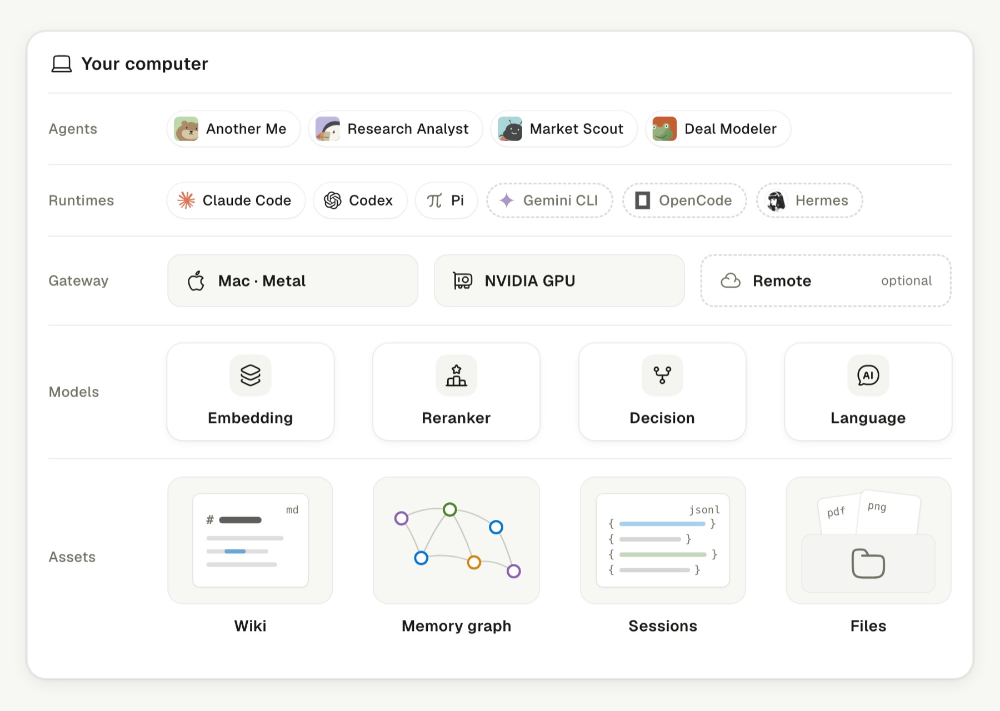

# Local Inference

**From the agent to its memory, every layer lives on your machine.**

Claude Code, Codex and Pi run as they always do, while a local gateway points
them at models on your own machine, with Gemini CLI, OpenCode and Hermes coming
next. Your wiki, memory, sessions and files stay on your disk, and a remote
model or the subscription you already pay for joins only when you ask. One
install sets up a language model, and it stays quick even on a fanless laptop.

How agents, approvals and background work share a model is in
[Model scheduling](model-scheduling.md).

## Planning

The planner chooses hardware and model settings together: layer by layer, the
machine's platform, free memory and bandwidth narrow the catalog until one model,
quantization, context window and KV precision remain, and the smaller models are
packed around it.

| Machine                      | Model               | Quant   | Context | Decode        | SimplexAI | Compares with        |
| ---------------------------- | ------------------- | ------- | ------- | ------------- | --------- | -------------------- |
| Mac 16 GB                    | Spark-X2.6-4B       | Q4_0    | 128K    | 165 tok/s     | 31.5      | Beats GPT-4o¹        |
| Mac 24 GB                    | Underdog-Saluki-27B | IQ2-mix | 128K    | 50 tok/s      | 48.4      | Beats Gemini 2.5 Pro |
| Mac 32 GB                    | Qwen3.8-27B         | IQ3_S   | 128K    | 46 tok/s      | 51.9      | Claude Opus 4.5      |
| NVIDIA 8 GB + 32 GB RAM      | Qwen3.8-Flash-Next  | IQ1_M   | 64K     | 95 tok/s      | 51.9      | Claude Opus 4.5      |
| NVIDIA 12 GB + 32 GB RAM     | Qwen3.8-Flash-Next  | IQ2_XXS | 64K     | 120 tok/s     | 54.8      | Claude Sonnet 4.6    |
| NVIDIA 24 GB + 64 GB RAM     | Qwen3.8-Flash-Next  | IQ3_XXS | 256K    | 167 tok/s     | 59.3      | Claude Opus 4.6      |
| NVIDIA 24 GB, two sessions\* | Qwen3.8-27B         | Q4_K_M  | 128K    | 41 tok/s each | 54.0      | Claude Sonnet 4.6    |

Decode is the best single-session result under ideal lab conditions, so expect
less on a laptop. SimplexAI scores sit on the third-party AIHOT scale, where 50 is
the average of 123 reference models, and scores within 3 points count as the same
level. Rows marked \* run two agent sessions that share one 128K context. ¹ GPT-4o
is not rated by AIHOT; the comparison uses vendor-reported GPQA Diamond (77.1 vs
53.6) and SWE-bench Verified (62.8 vs 33.2). Once the plan is approved, each model
counts as installed only after it answers a real question.

## Inference engines

Inference is built on PolyStrata: each token of a mixture-of-experts model uses only
a few of its experts, so the most-used ones stay next to the GPU and the rest wait
one level further away, in system RAM on a PC and on the SSD when a Mac runs out of
memory.

PolyStrata is open source (MIT) and runs Qwen3.8-Flash-Next on the Strata
engine.
