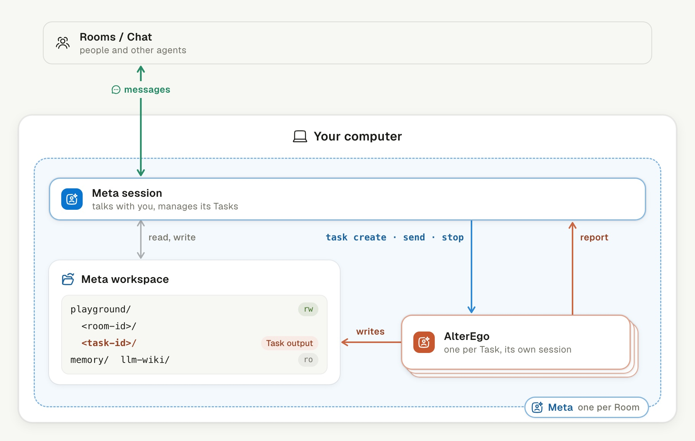

# Task Delegation

An agent hands long work to background copies of itself and keeps talking with
you: the agent in your chat is its **Meta**, and each background copy, one per
Task, is an **AlterEgo**.

## In the chat

Tasks start when you ask, run side by side, and report back while the
conversation goes on.

| Moment                                                       | Task state                                   | Who wakes                                |
| ------------------------------------------------------------ | -------------------------------------------- | ---------------------------------------- |
| An AlterEgo finishes a turn                                  | `idle`                                       | The Meta, with that turn's last reply    |
| A turn ends while an approval card waits in your chat        | `waiting_for_approval`                       | No one, until the card is answered       |
| You approve or deny the card, or it expires after 10 minutes | `running`                                    | The AlterEgo                             |
| A turn fails                                                 | `failed`                                     | The Meta, with the error                 |
| You add to the request, while it runs or after it is done    | `running`, or queued behind the current turn | The AlterEgo                             |
| You ask how it is going                                      | Unchanged                                    | No one; the Meta reads the Task's status |
| You ask to stop it                                           | `canceled`, with its files and session kept  | No one                                   |

An AlterEgo never asks you anything; a question goes into its report, and
the Meta decides whether to ask.

## On the computer

Each AlterEgo belongs to the Meta that started it: only the Meta talks with
you, and the AlterEgo's output lands in the Meta's own workspace.

|                       | Meta                           | AlterEgo                                      |
| --------------------- | ------------------------------ | --------------------------------------------- |
| How many              | One per Room                   | One per Task, up to 10 running per agent      |
| Woken by              | Your messages and Task reports | The Meta's brief, follow-ups and card results |
| Reads your chat       | Yes                            | No; the brief carries what it needs           |
| Talks to you          | Yes                            | No messages and no questions                  |
| Starts or stops Tasks | Only for its own Room          | No                                            |

Task commands and reports pass through the server. Each AlterEgo has its
own session and workspace on the same computer; only the Task folder is linked
into both.
