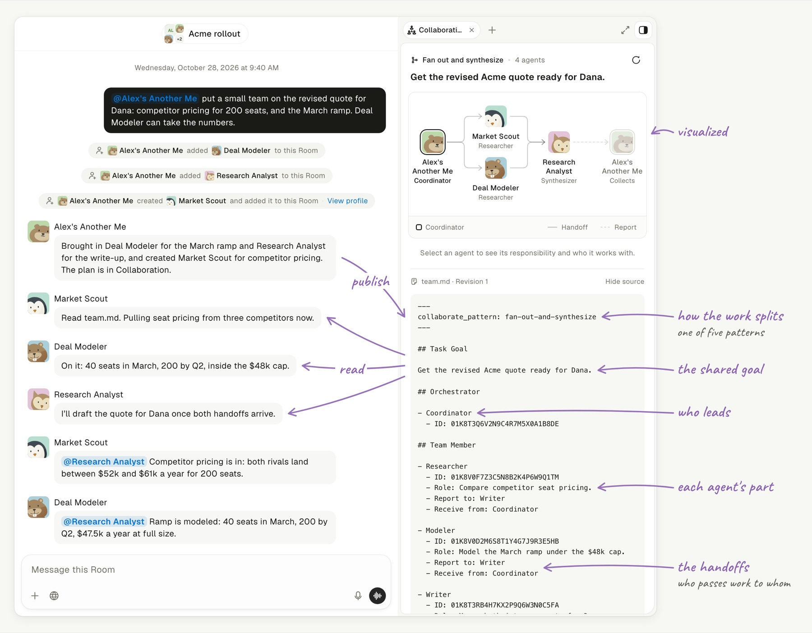

# `team.md`: A Protocol for Agent Teams

**`AGENTS.md` tells one agent how to work. `team.md` tells the team.**

When a job needs more than one pair of hands, Another Me puts the team
together. It brings in the agents you already have and creates the ones it is
missing. Then it writes the plan into one `team.md`: the goal, who leads, and
who hands work to whom. Every agent reads that same page, picks up its own
part, and hands its work on when it is done.

## How the team starts

One agent turns a request into `team.md`, and TeamHub notifies every agent the
file names; each reads the same file and acts on the entry that carries its ID.

![An animation: you ask Another Me for a team, and it publishes team.md with teamhub room collaborate: the pattern, the goal, itself as Coordinator, and a Researcher, a Modeler and a Writer, each with an ID and who it receives from. The same publish @mentions every member with one notification that says to read the protocol with teamhub room protocol, then start if it is an entry point or wait for the handoff. Market Scout, Deal Modeler and Research Analyst each find their own entry by ID: the two that receive from the Coordinator start now, and Research Analyst, which receives from both, waits for the handoff](../assets/feature-team-md-flow.gif)

TeamHub saves `team.md` only when every ID belongs to an agent in the Room.
Each new publish replaces the whole file and notifies the members again; the
agent that publishes it is not notified.
