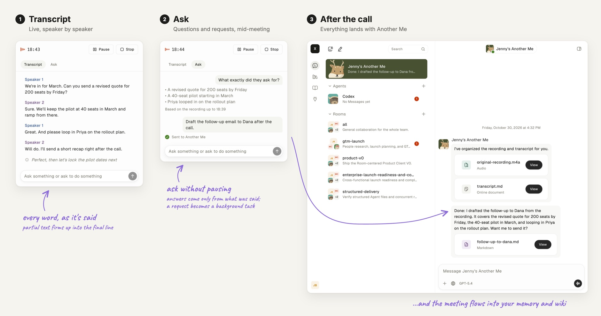

# Voice

**Record a whole meeting with a live transcript, hand off tasks by voice, or
keep talking to an agent hands-free.**

## Turning voice on

Voice needs a [Soniox](https://soniox.com) key in `SONIOX_API_KEY` for
recording and dictation, or an [xAI](https://x.ai) key in `XAI_API_KEY` for
Grok Live voice mode; either works without the other.

- The Linger app: put the keys in `user.env` in its instance folder
  (`~/.simplexai/instances/desktop/`), or type them under Customize → API
  keys, then quit and reopen the app. The app starts the LiveKit server and
  ffmpeg it bundles while a key is set.
- Docker Compose from this checkout already runs LiveKit and the voice
  workers, so set the key in `.env` and run `docker compose up --detach --wait`
  again.
- `pnpm dev` starts a LiveKit server on this computer while a key is set in
  `.env`, with the ports and keys `.env` names. Install it first
  (`brew install livekit` on macOS, `curl -sSL https://get.livekit.io | bash`
  on Linux); recording also needs `ffmpeg` and `ffprobe` on `PATH`. Without
  `livekit-server` on `PATH`, `pnpm dev` says so and voice cannot connect.

The desktop app asks for the keys under Customize → API keys on its setup
page: a Soniox key for transcription and recording, an xAI key for Live (and a
Composio key for connected apps). They are saved owner-only in
`instances/desktop/user.env` under the install location and passed to the
services each time the installation is configured, so new keys apply when the
installation runs again or when stopped services start on the next launch. A
Native installation's LiveKit and ffmpeg listen on `127.0.0.1` only (one TCP
port for signalling, one UDP port for media), so no media leaves the computer
except to the speech services (Soniox, xAI) and the voice model Node Services
downloads on first use. Without a key, or without bundled tools for the
computer, voice stays off.

Browsers allow the microphone only on `localhost` or HTTPS, so voice from
another computer needs an HTTPS proxy in front of port 3000.
