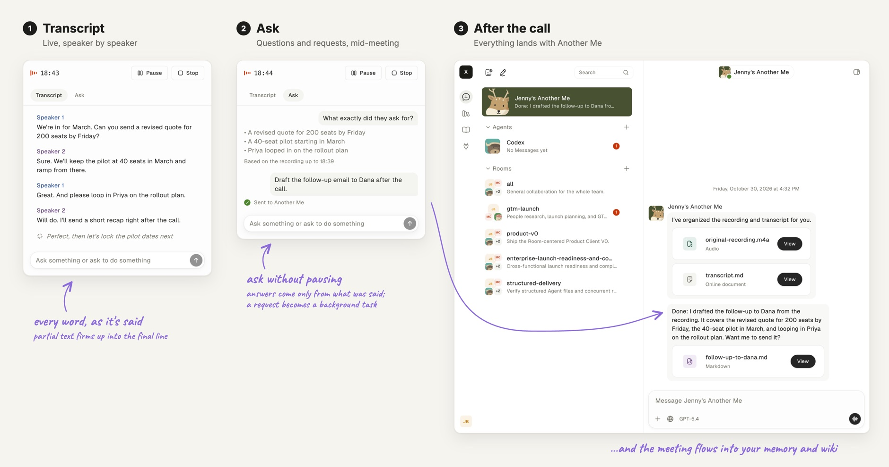

# Voice

**Record a whole meeting with a live transcript, hand off tasks by voice, or
keep talking to an agent hands-free.**

## Turning voice on

Voice runs wherever the deployment can run it: TeamHub's
`TEAMHUB_VOICE_MEDIA` is `on` (the default), `LINGER_SECRET_SEED` is set, and
`ffmpeg` and `ffprobe` are on `PATH`. `TEAMHUB_VOICE_MEDIA=off`, a missing seed,
or missing ffmpeg keep voice off; TeamHub still starts and logs
`voice.media_unavailable` for the last two.

Each feature then needs its provider key: [Soniox](https://soniox.com) for
recording and dictation, [xAI](https://x.ai) for Grok Live voice mode; either
works without the other. Set a key in `SONIOX_API_KEY` or `XAI_API_KEY`, or
save it in the app when voice asks for it. A saved key applies at once,
without a restart; an environment key wins over a saved one and cannot be
replaced from the app. Node Services starts the matching voice workers
within seconds of a save and stops them when a key goes away.

Saved keys are shared by everyone on the server, and any signed-in person can
save or replace one. Live transcription and archive recovery send the audio to
the Soniox account whose key is in effect, so on a server several people
share, set `SONIOX_API_KEY` and `XAI_API_KEY` in the environment: that locks
the keys against replacement from the app.

- The Linger app always runs the LiveKit server and ffmpeg it bundles; save
  the keys in the app. Keys written by hand into `user.env` in the instance
  folder (`~/.simplexai/instances/desktop/`) act as environment keys: they win
  over the app, and changing or removing one means editing that file and
  reopening the app. A computer the app has no bundled voice tools for keeps
  voice off.
- Docker Compose from this checkout always runs LiveKit; save the keys in the
  app, or set them in `.env` and run `docker compose up --detach --wait` again.
- `pnpm dev` always starts a LiveKit server on this computer, with the ports
  and keys `.env` names. Install it first (`brew install livekit` on macOS,
  `curl -sSL https://get.livekit.io | bash` on Linux); recording also needs
  `ffmpeg` and `ffprobe` on `PATH`. Without `livekit-server` on `PATH`,
  `pnpm dev` says so and voice cannot connect.

A Native installation's LiveKit signalling listens on `127.0.0.1` only (one TCP
port for HTTP/WebSocket), with media on one UDP port (`127.0.0.1` only on macOS
and Linux; local interfaces alongside `127.0.0.1` with ICE-Lite on Windows,
where the network stack blocks cross-scope UDP between WebRTC's non-loopback
sockets and `127.0.0.1`, keeping external IP discovery and public STUN off).
Because signalling stays loopback-only, ICE credentials never leave the
computer, and no media leaves the computer except to the speech services
(Soniox, xAI) and the voice model Node Services downloads when its voice role
starts. On Windows, binding non-loopback UDP interfaces can trigger a first-run
Windows Defender Firewall prompt, and switching networks or coming online after
an offline start requires restarting LiveKit because its single-port UDP mux
snapshots local interfaces at startup.

Browsers allow the microphone only on `localhost` or HTTPS, so voice from
another computer needs an HTTPS proxy in front of port 3000.

## Dictation without a key

With no Soniox key, dictation in the Message box and in Pocket notes runs on
SenseVoiceSmall int8, a speech model of about 230 MB that Node Services
downloads once into `AGENT_HOME/models` (from Hugging Face, or `hf-mirror.com`
first when `SIMPLEX_REGION` is `cn`) the first time it starts without a Soniox
key. The download resumes after an interruption, and its checksums are pinned.
Recognition runs on the CPU of the computer that runs Node Services; the audio
goes to no speech service.

While you speak, the text appears as it is recognized. In Voice Mode a pause of
about one second after you spoke ends the turn and sends it, as with Soniox. The
local model hears the pause by loudness alone, so it works in any language, but
a very noisy room can keep a turn from ending on its own. A long dictation is cut
into segments of at most 30 seconds, at the quietest moment near the end of
each, and each closed segment is rewritten, on the CLI your Another Me runs on
(the same Runtime that answers your chat) or on an API of your own, as chosen
below: it removes filler words, fixes mistakes in the recognized words, and adds
punctuation, without translating or changing what you said. The text lands in
the box when you stop, so stopping waits for the last segment's rewrite, up to
about ten seconds; if the CLI is offline or the rewrite is too slow or fails,
the recognized text is used as it is.

Dictation without a key stays off until someone chooses what rewrites the text.
With no Soniox key, the voice button opens the same dialog that takes the keys,
and its Local model page offers two ways to rewrite:

- **Claude CLI.** The page offers the aliases every Claude CLI takes (Haiku, the
  fastest, preselected, Sonnet and Opus), because the choice applies to whoever
  dictates on the server. The alias reaches that person's Claude CLI as
  `--model`; a Computer release before 0.62.0, or an Another Me that runs on
  Codex, keeps the Runtime's default model. A CLI starts a process for every
  rewrite, so expect several seconds.
- **My API key.** An OpenAI-compatible API of your own, such as DeepSeek:
  enter its https address and the key, then select the round button beside Model
  to list the models the API offers and pick one, or type a name (an API with no
  listing needs the typed name). A key already saved is used for that listing
  only while the address is the one it was saved for. TeamHub checks the key
  against the API's `/models` listing, stores it encrypted with
  `TEAMHUB_SECRET_ENCRYPTION_KEY` (without it the key cannot be saved), and
  never shows it again. Each segment of what you said is then sent to that API
  from the server running TeamHub, which connects only to public addresses, so
  an address inside your network is refused. A saved key stays when you switch
  back to the CLI, and goes only to the address it was saved for: another
  address needs a key of its own.

Use local model saves the choice and starts dictating. Like the keys, the choice
is shared by everyone on the server, and Settings › API keys has a Local model
row to change it later. The choice decides where everyone's dictated text goes,
so anyone who can sign in to the deployment can send it to an API they name. On
a server several people share, only let in people you trust with that, or leave
`TEAMHUB_SECRET_ENCRYPTION_KEY` unset, which keeps the API route off because no
key can be saved.

The local model labels no speakers, so recording still needs Soniox. A Soniox
key, once saved, takes over dictation again. `VOICE_LOCAL_ASR=0` keeps the
model from being downloaded; `VOICE_LOCAL_ASR_THREADS` caps its CPU threads.

## When a recording ends

As soon as a recording stops, Another Me posts the recording and its
transcript in its chat. A meeting summary follows under them a few seconds
later: a title and a few topics with short bullets, written from the transcript
by your Another Me's model. Grok Live reads the summaries of the recordings
among the chat's recent messages, so it can answer about a meeting that just
ended without opening its transcript. The full meeting notes (summary,
decisions, action items) take a few minutes more and appear in Library ›
Meetings; the card says so and links to them once they are written. If the
summary cannot be written, the recording and transcript stay as they are.
